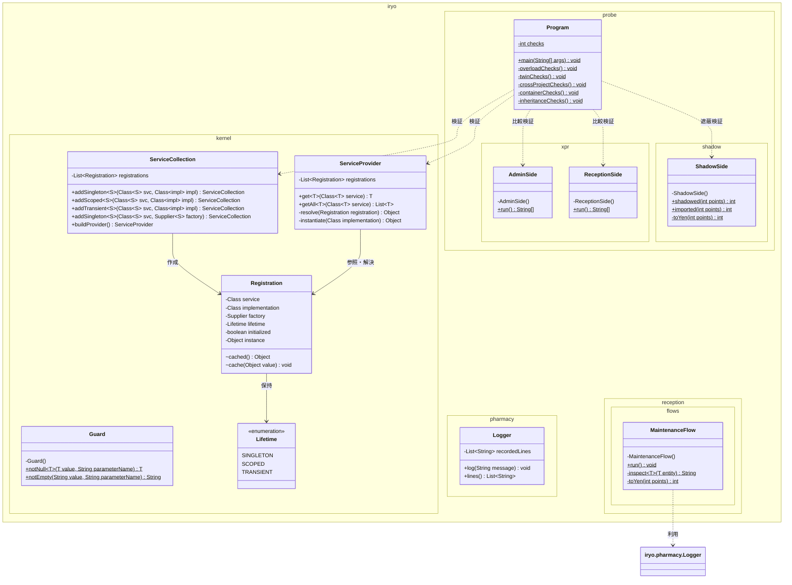
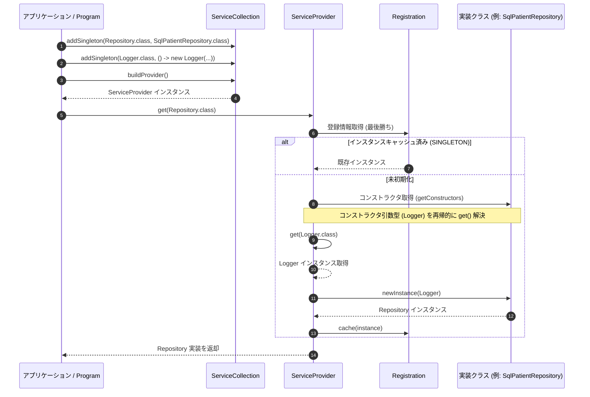
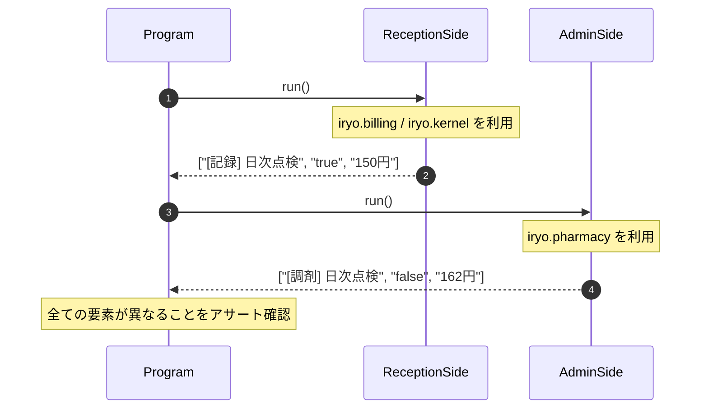
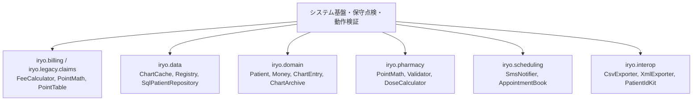

# システム基盤・保守点検・動作検証

## はじめに
「システム基盤・保守点検・動作検証」モジュールは、医療情報システムにおけるコア基盤機能の提供、日次保守プロセスの実行、およびJava言語仕様に準拠した名前解決・型束縛の整合性を実行時に検証するための基盤・テストハーネス群で構成されています。

本モジュールは大きく以下の3つの領域に分類されます。
1. **基盤カーネル（Kernel Infrastructure）**：引数検証（`Guard`）や軽量なDI（依存性注入）コンテナ（`ServiceCollection`, `ServiceProvider`）を提供し、各機能ブロックの疎結合な構築を支えます。
2. **保守点検フロー（Maintenance Operations）**：キャッシュのパージ、アーカイブ整理、各種エンティティ生成、オーバーロード構造の健全性を実査する運用手続き（`MaintenanceFlow`）を実行します。
3. **セマンティクス検証プローブ（Semantic Probes）**：インポート束縛の違い（`AdminSide` / `ReceptionSide`）、スコープ遮蔽（`ShadowSide`）、オーバーロード解決・型推論・コンテナライフサイクル（`Program`）などの整合性を、製品コードに改変を加えることなく実行時に証明します。

---

## アーキテクチャと設計

本モジュールでは、以下のアーキテクチャパターンおよびデザインパターンが適用されています。

- **Micro DI Container / Service Locator パターン**:
  `ServiceCollection` によるサービスの登録（インタフェースと実装型、またはファクトリ）と、`ServiceProvider` によるリフレクションを用いた自動コンストラクタ注入およびライフサイクル管理（シングルトン等のキャッシュ）。
- **Utility Class パターン**:
  `Guard`、`MaintenanceFlow`、`AdminSide`、`ReceptionSide`、`ShadowSide` などのクラスは、`final` 修飾子とプライベートコンストラクタによりインスタンス化を抑止し、ステートレスな静的メソッドを提供します。
- **Unmodifiable View パターン**:
  `iryo.pharmacy.Logger` において内部のログリストをカプセル化し、`Collections.unmodifiableList` を介して外部に公開することで、データ改ざんを防止します。
- **Ground Truth Semantic Probe パターン**:
  `Program` は、直列化可能ラムダ（`SerializedLambda`）のシグネチャ取得やリフレクション判定、出力ストリームのキャプチャを用い、バイトコードおよび言語セマンティクスの確定性を検証します。

### コンポーネント関係図

### モジュールコンポーネント

| コンポーネント | 責務 |
|---|---|
| **Guard** | 業務API引数の事前条件検証（`null`、空文字チェック）を行い、不正時に早期例外を送出する。 |
| **ServiceCollection** | DIコンテナ構築の合成ルート。サービス型、実装型、ファクトリ、ライフタイムを保持しプロバイダを生成する。 |
| **ServiceProvider** | コンストラクタ引数を再帰解決してインスタンスを生成・キャッシュし、単一解決または全件解決を提供する。 |
| **Logger**（pharmacy） | 調剤台帳専用のインメモキロガー。`[調剤]` プレフィックスを付与し、変更不能なリストとしてログ行を提供する。 |
| **MaintenanceFlow** | カルテキャッシュ操作、アーカイブ圧縮・整理、点数計算などのサブシステム全体の保守点検を一括実行する。 |
| **Program** | 型推論、オーバーロード解決、DI解決、継承仕様などを網羅的にテストするグラウンドトゥルース検証エントリポイント。 |
| **AdminSide** | 管理側のインポート宣言で束縛された同一手続きを実行し、名前解決の差異を検証する。 |
| **ReceptionSide** | 受付側のインポート宣言で束縛された同一手続きを実行し、名前解決の差異を検証する。 |
| **ShadowSide** | クラス内プライベートメソッドによる静的インポートの遮蔽（シャドウイング）ルールを検証する。 |

---

## データフロー

### 1. DIコンテナによる依存性解決フロー
`ServiceCollection` での登録から、`ServiceProvider` を介した再帰的な依存関係解決（コンストラクタインジェクション）までの流れを示します。

### 2. プロジェクト間インポート差異検証フロー（XPR）
コード手続きが完全に同一であっても、インポートされた型定義により実行結果が分岐することを検証するフローです。

---

## 主要コンポーネント

### Guard (`iryo.kernel`)
引数の防御的プログラミングを徹底するための検証ユーティリティです。
- `notNull(T value, String parameterName)`: 引数が `null` の場合に `IllegalArgumentException` をスローし、正常時は値をそのまま返します。
- `notEmpty(String value, String parameterName)`: 文字列が `null` または空白（`isBlank()`）の場合に例外を送出し、安全な値を保証します。

### ServiceCollection & ServiceProvider (`iryo.kernel`)
軽量な独自DIコンテナ機構を提供します。
- **ServiceCollection**:
  - `addSingleton`, `addScoped`, `addTransient` によるライフタイム指定の型登録。
  - `addSingleton(Class<S>, Supplier<S>)` によるファクトリラムダ登録。
  - `buildProvider()` により登録情報を不変化し、解決用プロバイダを返却。
- **ServiceProvider**:
  - `get(Class<T>)`: 同一型が複数登録されている場合は「最後勝ち（Last-Wins）」のルールで解決。
  - `getAll(Class<T>)`: 登録順序を維持したイミュータブルリストとして全インスタンスを取得。
  - 単一の `public` コンストラクタに定義された依存型を再帰的にコンテナから解決し、リフレクション経由でインスタンスを生成。

### Logger (`iryo.pharmacy`)
調剤台帳用の隔離されたロギングクラスです。
- `log(String message)`: メッセージに `[調剤] ` プレフィックスを付与して内部リストに蓄積。
- `lines()`: リストを変更不能ビュー（`Collections.unmodifiableList`）として返却。

### MaintenanceFlow (`iryo.reception.flows`)
システムの保守点検シナリオを一元化して実行するフロー制御クラスです。
- 新旧カルテキャッシュ（`ChartCache`）の読み書き。
- `ChartArchive.Compactor` および `ChartArchive.Janitor` によるストレージの整理・クリーンアップ。
- リフレクションを用いた `FeeCalculator` のオーバーロード数確認。
- ローカルの `toYen` （11倍計算）を用いた換算点検。

### Program (`iryo.probe`)
言語仕様・実行時バインディングを検証するプローブのメインクラスです。
- **overloadChecks**: プリミティブ拡大変換、ボックス化、可変長引数（Varargs）などの優先解決規則（Betterness）を検証。
- **twinChecks**: パッケージが異なる同名クラス（`Logger`, `Validator`, `PointMath`, `Money`, `Ward` など）が意図通り分離して解決されているかを検証。
- **crossProjectChecks**: 同一コード行が異なるインポート宣言によって振る舞いを変える挙動（XPR）を実測。
- **containerChecks**: DIコンテナの登録順序、上書き、コンストラクタ注入、未登録時の例外挙動を検証。

### ShadowSide (`iryo.probe.shadow`)
Java言語仕様（JLS 6.4.1）に基づく名前の遮蔽（Shadowing）を検証します。
- `shadowed(int)`: 非修飾呼び出し `toYen(points)` が、静的インポートされた `PointMath.toYen`（10倍）ではなく自クラスのプライベート静的メソッド（11倍）に解決されることを実証。
- `imported(int)`: `iryo.billing.PointMath.toYen(points)` の完全修飾呼び出しにより、意図したライブラリ側の処理を呼び出せることを実証。

---

## 依存関係

本モジュールは、システム内の複数のサブドメインに依存・連携しています。

1. **課金・レセプト系統 (`iryo.billing`, `iryo.legacy.claims`)**:
   - `FeeCalculator`, `PointMath`, `Validator`, `PointTable` 等の計算ロジックおよびオーバーロード解決の正当性検証。
2. **データアクセス・リポジトリ系統 (`iryo.data`)**:
   - `ChartCache`, `Registry`, `SqlPatientRepository` と DI コンテナのコンストラクタ解決およびキャッシュ機構の点検。
3. **ドメインモデル系統 (`iryo.domain`)**:
   - `Patient`, `ChartEntry`, `Money` (Record vs Class), `Ward` などのエンティティ構造および継承関係の確認。
4. **調剤系統 (`iryo.pharmacy`)**:
   - 会計側と同一名称を持つクラス群（`PointMath`, `Validator`, `Logger`, `Money`）の挙動差異（ツイン関係）の検証。
5. **通知・外部連携系統 (`iryo.scheduling`, `iryo.interop`)**:
   - `SmsNotifier` 等を用いた DI 実装の差し替え検証および各種エクスポート機能の動作確認。