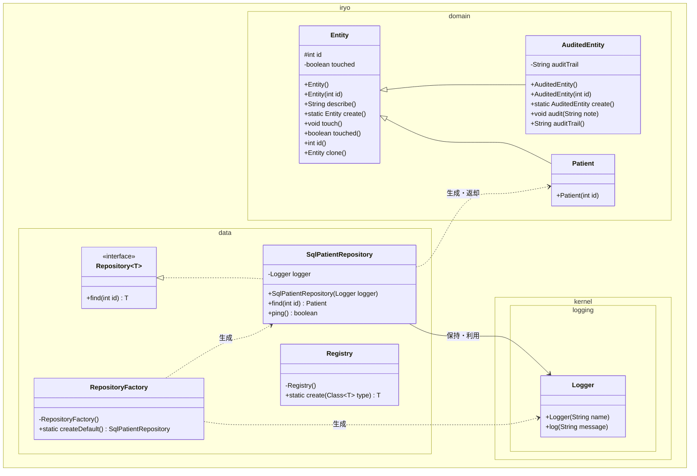

# データアクセス・エンティティ基盤

## はじめに
「データアクセス・エンティティ基盤」モジュールは、医療台帳システムにおけるドメインモデルの基本構造と、それらの永続化データへアクセスするための基底インフラストラクチャを提供するモジュールです。

本モジュールは、システム全体で利用される台帳エンティティの識別管理・状態追跡・監査証跡の基本機能（`iryo.domain` パッケージ）と、データベース等の永続化ストレージに対する汎用的なデータアクセス機構およびインスタンス生成ユーティリティ（`iryo.data` パッケージ）で構成されています。ドメインロジックと永続化処理の関心を分離し、一貫したデータアクセス基盤を提供することを主な目的としています。

---

## アーキテクチャと設計
本モジュールでは、保守性、拡張性、テスタビリティを高めるために以下のデザインパターンやアーキテクチャプラクティスを採用しています。

1. **Repositoryパターン (`Repository<T>`, `SqlPatientRepository`)**:
   エンティティの取得処理をインターフェースとして抽象化し、ドメインロジックが具体的な永続化メカニズム（SQL等）に直接依存しないように分離しています。
2. **Layer Supertypeパターン (`Entity`, `AuditedEntity`)**:
   すべてのドメインエンティティに共通する属性（識別子 `id`）や振る舞い（変更検知 `touch`、監査証跡記録 `audit`）を基底クラスに集約しています。
3. **Dependency Injection (DI) パターン (`SqlPatientRepository`)**:
   具象リポジトリが必要とする共通ロガー（`Logger`）をコンストラクタ経由で受け取ることで、結合度を下げテスト容易性を確保しています。
4. **Factoryパターン (`RepositoryFactory`, Static Factory Methods)**:
   オブジェクトの生成責務をカプセル化し、呼び出し元が複雑な初期化処理（依存関係の解決等）を意識せずに適切なインスタンスを取得できるようにしています。
5. **リフレクションによる動的生成 (`Registry`)**:
   クラス型情報に基づき、引数なしコンストラクタ経由で動的にオブジェクトを生成する汎用ユーティリティを提供しています。

### コンポーネント関係図


### モジュールコンポーネント
| コンポーネント | 責務 |
|-----------|----------------|
| **Entity** | すべての台帳エンティティの基底クラス。識別子（`id`）の保持、接触/変更状態（`touched`）の管理、複製、基本文字列表現を提供。 |
| **AuditedEntity** | 監査証跡（操作履歴のメモ）の蓄積・管理機能を追加した中間エンティティクラス。 |
| **Repository\<T\>** | 識別番号によるエンティティ取得操作を抽象化したデータアクセスインターフェース。 |
| **SqlPatientRepository** | `Repository<Patient>` を実装する患者台帳用SQLリポジトリ。ロギングを伴うデータ取得および疎通確認機能を提供。 |
| **RepositoryFactory** | バッチ処理等に向けた既定構成のリポジトリ（ロガー付き `SqlPatientRepository`）を生成するファクトリ。 |
| **Registry** | リフレクションを利用して、指定されたクラスの引数なしコンストラクタから動的にインスタンスを生成するユーティリティ。 |

---

## データフロー

以下は、バッチ処理やサービス層が `RepositoryFactory` を通じてリポジトリを取得し、患者エンティティを検索・取得する際の一連のデータフローです。

```mermaid
sequenceDiagram
    autonumber
    participant Client as 呼び出し元 (バッチ/サービス)
    participant Factory as RepositoryFactory
    participant Repo as SqlPatientRepository
    participant Logger as Logger
    participant Patient as Patient

    Client->>Factory: createDefault()
    activate Factory
    create participant Logger
    Factory->>Logger: new("工場")
    create participant Repo
    Factory->>Repo: new(Logger)
    Factory-->>Client: SqlPatientRepository インスタンス
    deselect Factory

    Client->>Repo: find(1001)
    activate Repo
    Repo->>Logger: log("患者検索 1001")
    activate Logger
    Logger-->>Repo: ログ出力完了
    deselect Logger
    create participant Patient
    Repo->>Patient: new(1001)
    Repo-->>Client: Patient インスタンス
    deselect Repo
```

---

## 主要コンポーネント

### 1. Entity (`iryo.domain.Entity`)
台帳ドメインモデルの根底をなすクラスです。
* **識別管理**: `protected int id` フィールドと `id()` ゲッターにより、一意の識別番号を保持・公開します。
* **状態追跡**: `touch()` メソッドを呼ぶことで `touched` フラグが `true` になり、エンティティに対する接触・更新イベントを検知できます。
* **生成と複製**: 静的ファクトリメソッド `create()` による引数なし生成や、Prototype パターンに基づく `clone()` メソッドによって現在のIDを引き継いだ別インスタンスの生成が可能です。

### 2. AuditedEntity (`iryo.domain.AuditedEntity`)
`Entity` を継承し、監査ログ機能を追加したクラスです。
* **証跡の記録**: `audit(String note)` メソッドを実行すると、引数の注記がセミコロン（`;`）区切りで内部文字列 `auditTrail` に順次追加されます。
* **証跡の参照**: `auditTrail()` メソッドを通じて蓄積された全監査証跡を取得できます。`describe()` メソッドは上書きせず、基底クラス `Entity` の表現をそのまま引き継ぎます。

### 3. Repository\<T\> (`iryo.data.Repository`)
データ永続化層との抽象境界を定義する汎用ジェネリックインターフェースです。
* **操作仕様**: `T find(int id)` のみを宣言しており、識別番号を指定して該当するエンティティオブジェクトを取得する規約を強制します。

### 4. SqlPatientRepository (`iryo.data.SqlPatientRepository`)
`Repository<Patient>` を実装した、患者データ専用の具象リポジトリクラスです。
* **依存性注入**: コンストラクタで `iryo.kernel.logging.Logger` を受け取ります。
* **患者検索**: `find(int id)` 実行時にロガーへ検索対象IDを記録し、対応する `Patient` インスタンスを返却します。
* **疎通確認**: `ping()` メソッドを提供し、データストア接続の健全性を確認する手段を提供します。

### 5. RepositoryFactory (`iryo.data.RepositoryFactory`)
具象リポジトリの生成を集約するユーティリティクラスです。
* `createDefault()` メソッドにより、「工場」という識別名を持つロガーが注入された `SqlPatientRepository` を即座に構築して提供します。外部からの直接インスタンス化を防ぐため、コンストラクタは `private` 化されています。

### 6. Registry (`iryo.data.Registry`)
Java リフレクションAPIを利用して型安全かつ動的にコンポーネントを生成するヘルパークラスです。
* `create(Class<T> type)` メソッドにより、指定されたクラスの `public` な引数なしコンストラクタを呼び出してインスタンスを生成します。
* 発生し得る各種リフレクション例外（`NoSuchMethodException` 等）は、実行時例外である `IllegalArgumentException` にラップされて再スローされるため、呼び出し元でのボイラープレートな検査例外処理を削減します。

---

## 依存関係

本モジュールは、以下の外部クラスおよび同一システム内の別モジュールに依存しています。

* **`iryo.kernel.logging.Logger`**:
  カーネル共通基盤のロギングモジュール。`SqlPatientRepository` のログ出力および `RepositoryFactory` 内での初期化時に依存しています。
* **`iryo.domain.Patient`**:
  患者エンティティクラス。`SqlPatientRepository` が実装する `Repository<Patient>` の型引数および戻り値として参照されています。
* **Java Standard Library (java.lang.reflect)**:
  `Registry` クラスにおいて、実行時の動的リフレクション呼び出し（コンストラクタの取得およびインスタンス化）のために標準APIを使用しています。