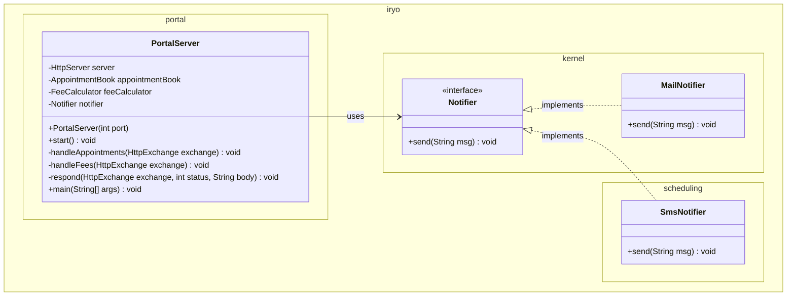
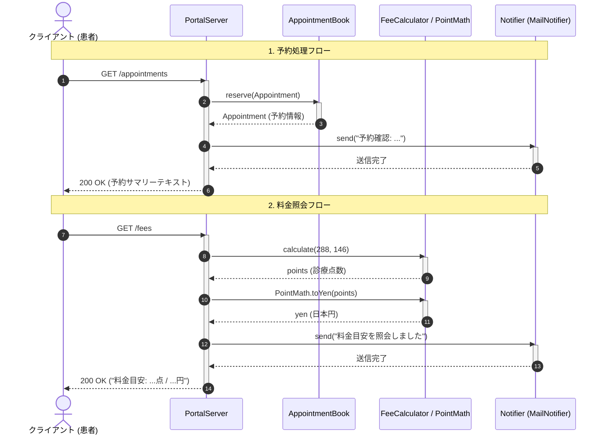

# ポータル・通知連携

## はじめに
本モジュールは、患者向けにWebインターフェース（HTTPエンドポイント）を提供する「患者ポータル機能」と、予約確定や料金照会に伴う連絡を行う「通知機能」の連携を担うコンポーネント群です。

医療システム全体において、本モジュールは患者や外部クライアントとシステム内部の各ドメイン（予約管理・診療報酬請求）を橋渡しするエントリーポイント（境界層/プレゼンテーション層）として位置づけられています。また、メッセージ通知のインターフェースを共通カーネル層に定義し、メールやSMSなどの具象実装を柔軟に切り替えられる疎結合な通知基盤を提供します。

---

## アーキテクチャと設計
本モジュールでは、以下の設計パターンおよび原則が採用されています。

- **Strategyパターン / 依存性逆転の原則（DIP）**
  通知手段を `Notifier` インターフェースとして抽象化し、具象実装である `MailNotifier` や `SmsNotifier` とクライアント（`PortalServer` など）を分離しています。これにより、新しい通知手段の追加や変更が容易に行えます。
- **Facade / Gatewayパターン**
  `PortalServer` は Java標準の `HttpServer` を利用した軽量APIゲートウェイとして機能し、予約ドメイン（`AppointmentBook`）や請求ドメイン（`FeeCalculator`, `PointMath`）の機能を束ねてシンプルなHTTPインターフェースとして公開します。

### コンポーネント関係図

### モジュールコンポーネント
| コンポーネント | 責務 |
|---|---|
| **`Notifier`** | 患者や職員へ連絡を行うための送信インターフェースを定義。 |
| **`MailNotifier`** | 院内既定の電子メールを用いた通知処理の具象実装。 |
| **`SmsNotifier`** | 予約部門等で利用されるSMS（ショートメッセージ）を用いた通知処理の具象実装。 |
| **`PortalServer`** | 患者向け予約受付および診療料金照会のHTTPエンドポイントを公開・制御するサーバー。 |

---

## データフロー

以下は、患者（クライアント）が予約エンドポイント（`/appointments`）および料金照会エンドポイント（`/fees`）へアクセスした際のデータフローです。

---

## 主要コンポーネント

### 1. `Notifier` (`iryo.kernel`)
通知機能の基盤となるインターフェースです。
- **`send(String msg)`**: 引数に渡されたメッセージ文字列を指定された通知チャネル経由で送信します。通知チャネルの具象実装に関わらず統一されたメソッドシグネチャを提供します。

### 2. `MailNotifier` (`iryo.kernel`)
院内既定のメール通知を行う `Notifier` の具象クラスです。
- **`send(String msg)`**: 受け取ったメッセージをフォーマットし、メール送信処理（標準出力シミュレーション）を実行します。

### 3. `SmsNotifier` (`iryo.scheduling`)
予約部門が提供するSMS通知を行う `Notifier` の具象クラスです。
- **`send(String msg)`**: モバイル端末等に向けたSMS送信処理（標準出力シミュレーション）を実行します。

### 4. `PortalServer` (`iryo.portal`)
Java標準の `com.sun.net.httpserver.HttpServer` を内蔵し、RESTライクなエンドポイントを提供するHTTPサーバーです。
- **`PortalServer(int port)`**: ポート番号を受け取りサーバーを初期化し、`/appointments` および `/fees` のハンドラーを登録します。
- **`start()`**: サーバーを起動し、リクエストの受付を開始します。
- **`handleAppointments(HttpExchange exchange)`**: 予約登録を行い、通知を送信後、結果サマリーをプレーンテキストで返却します。
- **`handleFees(HttpExchange exchange)`**: 診療報酬点数および円換算の料金を計算し、通知を送信後、料金目安を返却します。
- **`respond(HttpExchange exchange, int status, String body)`**: HTTPレスポンスヘッダー（`Content-Type: text/plain; charset=UTF-8`）およびステータスコードを設定し、レスポンス本文を送信する共通ユーティリティです。

---

## 依存関係

本モジュールは、以下の外部パッケージ・他モジュールと依存関係を持っています。

| 依存先パッケージ | 参照クラス | 用途 |
|---|---|---|
| **`iryo.billing`** | `FeeCalculator` | 診療点数の計算処理の呼び出し |
| | `PointMath` | 診療点数から日本円への換算処理 |
| **`iryo.scheduling`** | `AppointmentBook` | 予約枠の確保・登録処理 |
| **`iryo.domain`** | `Appointment` | 予約情報を表すドメインモデルのインスタンス化 |
| **`com.sun.net.httpserver`** | `HttpServer`, `HttpExchange` | 軽量HTTPサーバーおよび通信コンテキストの管理 |