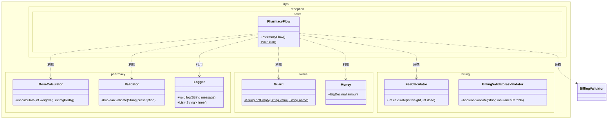
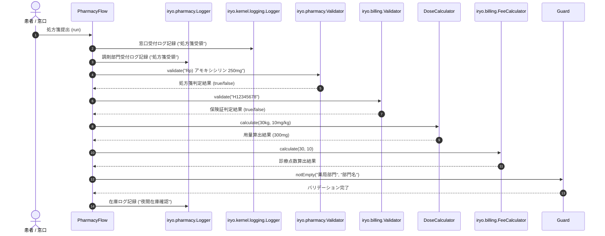

# 処方箋・調剤・投薬管理

## はじめに
「処方箋・調剤・投薬管理」モジュールは、医療情報システムにおいて薬局窓口業務および調剤業務の中核を担うモジュールです。医師から発行された処方箋の受取・様式検証から、患者ごとの適切な投薬量の算出、調剤処理、夜間在庫管理、および請求部門（レセプト）や受付フローとの連携を一括して管理します。

本モジュールは、医療安全に直結する用量計算や処方箋フォーマットチェックを自己完結型のコンポーネントとして提供し、業務フローオーケストレーションを通じて他部門（受付、請求、共通基盤）とシームレスに結合する位置づけにあります。

---

## アーキテクチャと設計
本モジュールは、軽量なドメイン駆動設計（DDD）のアプローチを採用しており、以下のパターンで構成されています。

1. **ドメインサービス（ステートレスサービス）**:
   `DoseCalculator` や `Validator` は状態を持たない（ステートレスな）サービスとして実装されており、スレッドセーフかつ再利用性の高い設計となっています。継承を禁止する `final` クラスとして定義され、責務の局所化が図られています。
2. **フローオーケストレーター（業務トランザクション制御）**:
   `PharmacyFlow` は、ファサード/スクリプトパターンに基づき、処方箋の受取・ログ記録・バリデーション・用量計算・在庫評価・点数計算に至る一連のユースケースをオーケストレーションします。

### コンポーネント関係図

### モジュールコンポーネント

| コンポーネント | パッケージ | 責務 |
| :--- | :--- | :--- |
| **`PharmacyFlow`** | `iryo.reception.flows` | 薬局窓口における処方箋受領から検証、用量計算、請求連携、在庫確認に至る業務フロー全体を実行・調整する。 |
| **`DoseCalculator`** | `iryo.pharmacy` | 患者の体重および単位投与基準量に基づき、1回あたりの薬物投与量（mg）を安全に計算する。 |
| **`Validator`** | `iryo.pharmacy` | 入力された処方箋テキストが処方指示の様式要件（「Rp」の存在確認など）を満たしているかを検証する。 |
| **`Logger`** | `iryo.pharmacy` | 薬局部門内における処理履歴や業務イベントログ（受領ログ、夜間在庫ログなど）を記録・保持する。 |

---

## データフロー

薬局窓口に処方箋が届いてから調剤・監査・在庫確認が行われる一連の流れを以下に示します。

---

## 主要コンポーネント

### 1. DoseCalculator (`iryo.pharmacy.DoseCalculator`)
小児科や体重に応じた精密な薬物投与が必要な場面で使用される用量計算コンポーネントです。

- **メソッド**:
  - `int calculate(int weightKg, int mgPerKg)`:
    - 引数: 患者の体重（kg）、および体重1kgあたりの投与量（mg/kg）
    - 戻り値: 1回あたりの総投与量（mg）
    - 特徴: 状態を持たないピュアな関数型計算ロジックであり、外部副作用がありません。

### 2. Validator (`iryo.pharmacy.Validator`)
処方箋テキストデータの構文整合性を検証するコンポーネントです。

- **メソッド**:
  - `boolean validate(String prescription)`:
    - 引数: 検証対象の処方箋文字列
    - 戻り値: 処方箋が非nullであり、かつ「Rp」（Recipe: 処方指示記号）を含んでいる場合に `true`、それ以外は `false` を返却。

### 3. PharmacyFlow (`iryo.reception.flows.PharmacyFlow`)
調剤部門と周辺システムをつなぐ業務制御ファサードです。

- **特徴**:
  - プライベートコンストラクタにより、不要なインスタンス化を防止。
  - 静的メソッド `run()` 内で受付ログ、調剤ログ、処方箋様式判定、保険証判定、投薬量計算、レセプト点数算出、在庫評価額算出、事前条件ガード（`Guard.notEmpty`）の一連のシナリオを実行します。

---

## 依存関係

本モジュールは、システムのモジュール間結合度を適切に保ちつつ、以下の外部モジュールと連携しています。

| 依存先パッケージ | 参照コンポーネント | 依存の目的 |
| :--- | :--- | :--- |
| **`iryo.kernel`** | `Money` | 在庫評価額などの通貨・金額計算を高精度に処理するため。 |
| | `Guard` | 部門名などの必須入力値や事前条件チェックを安全に行うため。 |
| | `iryo.kernel.logging.Logger` | システム全体の共通受付ログを記録するため。 |
| **`iryo.billing`** | `Validator` | 提示された保険証の有効性を処方確定前に照合・判定するため。 |
| | `FeeCalculator` | 処方内容に応じた診療報酬点数を算定し、会計部門へ受け渡すため。 |
| **Java 標準ライブラリ** | `java.math.BigDecimal` | `Money` の内部金額表現として使用。 |