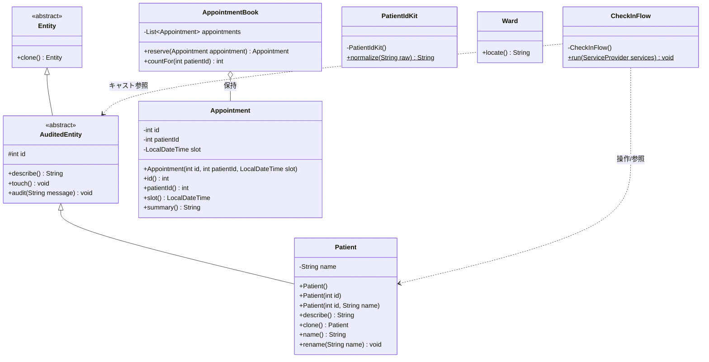
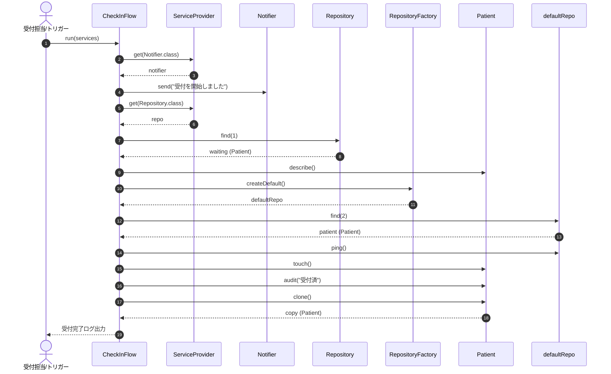

# 患者・予約・受付管理

## はじめに
「患者・予約・受付管理」モジュールは、医療機関向けシステムにおける患者基本台帳の管理、診察予約の登録・保持、および来院時の受付手続きを統括するコアモジュールです。

本モジュールは、患者エンティティのライフサイクル（生成、属性変更、監査履歴記録）を管理するとともに、不変な診察予約データ（`Appointment`）の生成や、それを束ねる予約台帳（`AppointmentBook`）によるスケジューリング機能を提供します。また、サービスプロバイダやリポジトリ層と連携して受付業務を一気通貫で処理するオーケストレーション機能（`CheckInFlow`）や、外部システム間連携を支援するID正規化ユーティリティ（`PatientIdKit`）を備えています。

---

## アーキテクチャと設計
本モジュールは、ドメイン駆動設計（DDD）の原則とオブジェクト指向設計のベストプラクティスを採用しています。

- **イミュータブル（不変）エンティティパターン**: `Appointment` は完全な不変オブジェクトとして設計されており、マルチスレッド環境下での安全性および参照透過性を確保しています。
- **ファーストクラスコレクション**: `AppointmentBook` は単なる汎用リストのラッパーではなく、予約の追加や特定患者の予約件数集計といったビジネスロジックをカプセル化しています。
- **監査エンティティ階層（レイヤードドメイン）**: `Patient` は共通基底クラス `AuditedEntity`（および `Entity`）を継承し、アイデンティティと監査ログ（アクセス日時、ステータス変更）を安全に保持・伝播します。
- **ワークフロー（オーケストレーション）パターン**: `CheckInFlow` が静的実行エントリポイントとして機能し、サービスロケータ（`ServiceProvider`）から各種インフラコンポーネント（`Notifier`、`Repository`）を取得して一連の来院受付処理を調整します。
- **ユーティリティクラス**: `PatientIdKit` はインスタンス化を抑止した純粋関数的な文字列変換ユーティリティとして提供されています。

### コンポーネント関係図

### モジュールコンポーネント

| コンポーネント | 責務 |
|-----------|----------------|
| **Patient** | 患者の識別子（ID）および氏名を保持するドメインエンティティ。台帳監査クラスを継承し、クローン生成や氏名変更を担う。 |
| **Appointment** | 予約ID、対象患者ID、予約枠日時（`LocalDateTime`）を保持する不変の予約値オブジェクト/エンティティ。 |
| **AppointmentBook** | 確定済み予約の一覧をインメモリでカプセル化して管理し、予約の追加や患者別予約件数のカウントを行う台帳クラス。 |
| **CheckInFlow** | 来院受付ワークフローを実行するオーケストレータ。通知送信、リポジトリ照会、監査ログ付与、複製処理を統括する。 |
| **PatientIdKit** | 外部システムと連携する際に、患者IDの前後の空白除去、大文字統一、スペースのハイフン置換による正規化を行うユーティリティ。 |
| **Ward** | 病棟情報を提供するドメインクラス。北病棟の位置・案内情報を返却する。 |
| **patient_view.jsp** | 旧システム画面のJSPテンプレート。移行確認用の非配信アーカイブ資産。 |

---

## データフロー

以下は、`CheckInFlow.run()` メソッドを実行した際の、来院受付および患者台帳照会処理のシーケンスです。

---

## 主要コンポーネント

### 1. Patient (`iryo.domain.Patient`)
患者台帳の中核となるエンティティです。
- **基底クラスの継承**: `AuditedEntity` を継承しており、IDによる同一性管理に加え、最終アクセス日時（`touch`）や監査記録（`audit`）のプロパティを引き継ぎます。
- **オーバーロードコンストラクタ**: デフォルト（ID: 0）、ID指定（氏名は「患者{ID}」と自動生成）、ID・氏名指定の3つのコンストラクタを提供します。
- **状態操作**: `rename(String)` による氏名更新が可能です。
- **自己複製**: `clone()` メソッドをオーバーライドし、同一のIDと氏名を持つ独立した新しい `Patient` インスタンスを安全に生成します。

### 2. Appointment (`iryo.domain.Appointment`)
診察予約を表すイミュータブルクラスです。
- **不変性**: クラスおよび全フィールド（`id`, `patientId`, `slot`）が `final` として定義されています。
- **フォーマット出力**: `summary()` メソッドにより、予約日時を `yyyy-MM-dd HH:mm` 形式に整形した人間可読な文字列を出力します。

### 3. AppointmentBook (`iryo.scheduling.AppointmentBook`)
確定した診察予約群を保持・操作するファーストクラスコレクションです。
- **予約の確定（`reserve`）**: 予約リストに `Appointment` を追加し、登録されたインスタンスを返却します。
- **件数集計（`countFor`）**: 特定の患者IDに紐付く予約の登録件数を集計して返却します。

### 4. CheckInFlow (`iryo.reception.flows.CheckInFlow`)
受付窓口での来院処理手順をコード化したフローコントローラです。
- サービスプロバイダを介して通知システムや患者リポジトリを動的に取得します。
- 患者台帳の検索、ping による接続性検証、エンティティのアクセス記録・監査ステータス更新を一括して実行します。

### 5. PatientIdKit (`iryo.interop.PatientIdKit`)
外部の電子カルテや検査システムとのデータ連携時に使用する文字列処理クラスです。
- **`normalize(String raw)`**: 入力文字列の前後トリム、`Locale.ROOT` に基づく大文字化、半角スペースのハイフン置換を行い、一貫したフォーマットに変換します。

### 6. Ward (`iryo.domain.north.Ward`)
病棟案内ドメインです。
- `locate()` メソッドにより対象病棟（「北病棟」）の名称を返却します。

### 7. patient_view.jsp
旧Webシステムで使用されていたJSPテンプレートです。現行のポータル配信対象外となっており、新旧画面のマイグレーション検証・参照用資産として保持されています。

---

## 依存関係

本モジュールは、システム内の以下の他レイヤー・パッケージと依存関係を持ちます。

### 外部モジュール・インターフェース依存
- **`iryo.kernel`**
  - `ServiceProvider`: サービスロケータとして、通知手段やリポジトリのインスタンス解決に使用（`CheckInFlow`）。
  - `Notifier`: 窓口受付開始などのシステム通知配信インターフェース。
- **`iryo.data`**
  - `Repository`: 患者データの検索（`find(id)`）を行うリポジトリインターフェース。
  - `RepositoryFactory`: デフォルトのデータ永続化層へのアクセサを生成するファクトリ。
- **`iryo.domain (共通基底)`**
  - `AuditedEntity`: 監査ログ記録機能（`audit`、`touch`）を提供する抽象基底クラス。
  - `Entity`: システム全体の最上位エンティティ基底クラス（`clone` 等を定義）。

### Java標準APIへの依存
- `java.time.LocalDateTime`, `java.time.format.DateTimeFormatter`: 予約日時の管理およびフォーマット。
- `java.util.List`, `java.util.ArrayList`: 予約コレクションの管理。
- `java.util.Locale`: ロケール非依存なID正規化処理（`Locale.ROOT`）。