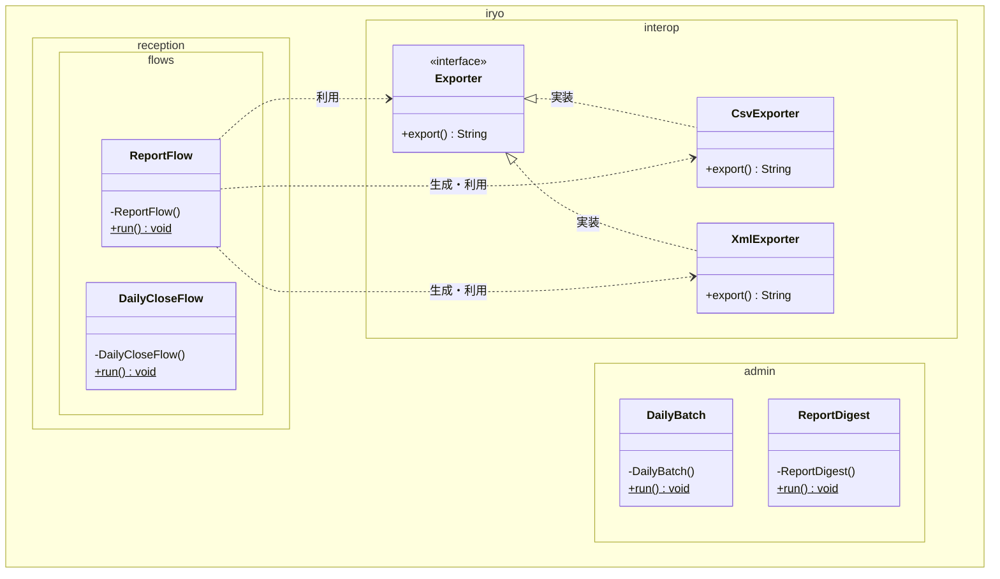
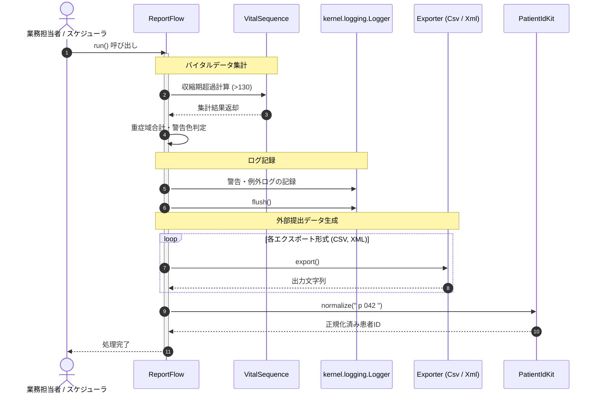

# 業務日報・バッチ・データ出力

## はじめに
「業務日報・バッチ・データ出力」モジュールは、医療情報管理システムにおいて、日次・週次の定常業務実行、業務集計、および外部システム向けデータ出力機能を提供するモジュールです。

本モジュールは以下の役割を担い、管理者層（`iryo.admin`）、受付業務層（`iryo.reception.flows`）、外部連携層（`iryo.interop`）にまたがる業務プロセスを支えます。

* **日次バッチ・締め処理**: 管理者向けの日次点検タスク（調剤部門の検証や点数換算）および受付端末での日次締めフローの実行
* **統計・集計レポート**: バイタルデータ（脈拍・血圧等）の傾向分析、警告判定、および外来・入院を含めた収益の週次集計
* **データ相互運用（インターオペラビリティ）**: 外部機関や他システムへの提出用データ（CSV / XML 等）のフォーマット変換・出力

---

## アーキテクチャと設計
本モジュールでは、保守性・疎結合性・拡張性を確保するために以下の設計パターンを採用しています。

1. **Strategy パターン（データ出力）**
   `Exporter` インターフェースを定義し、具象クラスである `CsvExporter` や `XmlExporter` に出力フォーマット別のロジックを委譲しています。これにより、呼び出し側コードに手を加えることなく新しい出力形式（JSON 等）を追加できます。
2. **Utility Class パターン（業務フロー実行）**
   `DailyBatch`、`DailyCloseFlow`、`ReportDigest`、`ReportFlow` はすべて `final` クラスかつ `private` コンストラクタを持ち、状態を持たずに静的メソッド `run()` を通じて一連の業務シーケンスを実行するユーティリティクラスとして実装されています。
3. **ドメイン関心事の分離**
   管理者向けバッチ（調剤領域にフォーカス）と受付日次締め（請求・会計領域にフォーカス）で利用するロガーやバリデータを適切に使い分け、業務責務の境界を明確に保っています。

### コンポーネント関係図

### モジュールコンポーネント

| コンポーネント | パッケージ | 責務 |
|---|---|---|
| **Exporter** | `iryo.interop` | 外部提出データの出力方式を規定する共通インターフェース。 |
| **CsvExporter** | `iryo.interop` | `Exporter` を実装し、CSV 形式でのデータ出力を担当。 |
| **XmlExporter** | `iryo.interop` | `Exporter` を実装し、XML 形式でのデータ出力を担当。 |
| **DailyBatch** | `iryo.admin` | 調剤部門の点検、様式バリデーション、点数換算を統括する管理者向け日次バッチ。 |
| **ReportDigest** | `iryo.admin` | 脈拍超過傾向の集計および外来・入院収益の合算を行う週次ダイジェスト処理。 |
| **DailyCloseFlow** | `iryo.reception.flows` | 受付端末における日次点検、請求コード様式検証、点数換算を行う締め処理フロー。 |
| **ReportFlow** | `iryo.reception.flows` | バイタル集計（収縮期・重症域判定）、ログ管理、病棟案内確認、外部提出データ出力を統合実行する日報フロー。 |

---

## データフロー

日報作成および外部データ出力（`ReportFlow`）と、受付締め処理（`DailyCloseFlow`）の代表的な実行シーケンスは以下のとおりです。

---

## 主要コンポーネント

### 1. `Exporter` / `CsvExporter` / `XmlExporter`
外部システム連携のための Strategy パターン基盤です。
* **`Exporter`**: `String export()` を唯一のメソッドとして定義する抽象インターフェースです。
* **`CsvExporter`**: `Exporter` を実装し、データを CSV 形式の文字列表現として出力します。
* **`XmlExporter`**: `Exporter` を実装し、データを XML 形式の文字列表現として出力します。

### 2. `DailyBatch`
調剤管理を含む管理者向けの日次バッチクラスです。
* **`run()`**: 調剤パッケージ（`iryo.pharmacy`）に依存し、以下の点検タスクを順次実行します。
  1. `iryo.pharmacy.Logger` による点検ログ記録
  2. `iryo.pharmacy.Validator` によるコード（例: `"H12345678"`）の様式判定
  3. `iryo.pharmacy.PointMath.toYen(15)` による調剤点数から日本円への換算

### 3. `DailyCloseFlow`
受付端末における日次締めタスクを統括するクラスです。
* **`run()`**: 請求・基盤パッケージに依存し、受付締め処理を実施します。
  1. `iryo.kernel.logging.Logger` による日次点検ログ出力
  2. `iryo.billing.Validator` による請求コード様式判定
  3. `iryo.billing.PointMath.toYen(15)` による請求点数から日本円への換算

### 4. `ReportDigest`
管理層向けの週次集計処理をカプセル化したクラスです。
* **`run()`**:
  1. 脈拍値リスト（70, 88, 64）から 65 超の値を抽出し、基準値 60 からの超過分合計を Java Stream API で算出
  2. 外来（150,000円）および入院（98,000円）の金額（`iryo.domain.Money`）を加算し、週間総収益を算出・表示

### 5. `ReportFlow`
受付・現場向けの日報生成、バイタル分析、外部出力を行う統合フロークラスです。
* **`run()`**:
  1. `VitalSequence` を利用した収縮期血圧超過値のフィルタ・合算
  2. 重症域バイタルの集計と AWT の `Color.RED` を用いた警告色判定
  3. ロガー（`Logger`）への例外および確認ログの記録と `flush`
  4. 病棟モデル（北病棟・南病棟）の配置確認
  5. 登録された複数の `Exporter`（CSV / XML）を順次実行
  6. `PatientIdKit.normalize()` による入力患者IDのトリム・正規化処理

---

## 依存関係

本モジュールは、システム内の以下の外部および他ドメインパッケージと連携しています。

| 依存先パッケージ / クラス | 参照元クラス | 用途 |
|---|---|---|
| `iryo.pharmacy` (`Logger`, `Validator`, `PointMath`) | `DailyBatch` | 調剤部門向けロギング、識別様式チェック、点数-円換算 |
| `iryo.billing` (`Validator`, `PointMath`) | `DailyCloseFlow` | 請求部門向け識別様式チェック、点数-円換算 |
| `iryo.kernel.logging.Logger` | `DailyCloseFlow`, `ReportFlow` | 基盤共通ロギング（レベル指定ログ、例外ロギング、フラッシュ処理） |
| `iryo.domain.Money` | `ReportDigest` | 収益の合算処理（金額計算のドメインモデル） |
| `iryo.reporting` (`KarteKit`, `VitalSequence`) | `ReportDigest`, `ReportFlow` | 帳票ヘッダー出力（`heading`）およびバイタルデータシーケンス集計 |
| `iryo.domain.north.Ward`, `iryo.domain.south.Ward` | `ReportFlow` | 病棟配置情報の取得 |
| `iryo.interop.PatientIdKit` | `ReportFlow` | 患者ID文字列のクレンジング・正規化 |
| `java.awt.Color` | `ReportFlow` | アラート表示用カラーの取得 |
| `java.math.BigDecimal` | `ReportDigest` | 金額演算における精度の担保 |