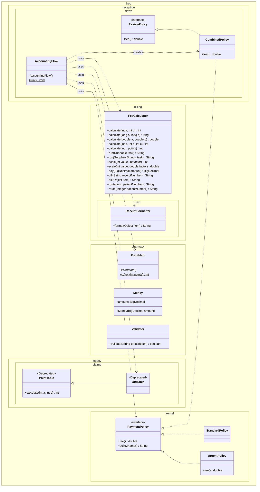
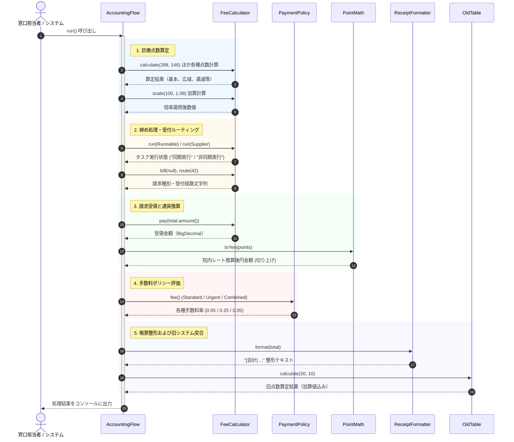

# 診療報酬・医療会計管理

## はじめに
「診療報酬・医療会計管理」モジュールは、医療機関における窓口会計業務全般を司る中核コンポーネントです。診療行為に伴う診療報酬点数の算定をはじめ、院内・調剤レートに基づく円換算、時間外や救急等の診療条件に応じた事務手数料ポリシーの適用、窓口請求額および受領額の管理、領収書テキストの整形出力、さらには旧診療点数表との互換突合照合までを一元的にカバーします。

本モジュールは、受付窓口フロー（`iryo.reception`）、請求・算定ドメイン（`iryo.billing`）、全体共通ポリシー（`iryo.kernel`）、薬局・調剤ドメイン（`iryo.pharmacy`）、レガシー請求データ連携（`iryo.legacy.claims`）の各境界を跨ぎ、協調動作させる位置づけにあります。

---

## アーキテクチャと設計
本モジュールでは、関心の分離（SoC）と高い保守性・拡張性を実現するために、以下のデザインパターンおよび設計原則が適用されています。

1. **Facade（ファサード）パターン**
   - `AccountingFlow` が各サブシステム（点数算定、ポリシー判定、通貨換算、帳票整形、レガシー照合）の窓口となり、一連の会計処理ワークフローを隠蔽・統合管理します。
2. **Strategy（ストラテジー）パターン**
   - 事務手数料の算定方針を `PaymentPolicy` インターフェースで抽象化し、`StandardPolicy`（通常時）、`UrgentPolicy`（時間外・救急時）、`CombinedPolicy`（併用判定）などの具体的な手数料算出ルールを実行時に柔軟に切り替えることができます。
3. **Value Object（値オブジェクト）パターン**
   - 金銭情報（`Money`）をプリミティブ型ではなくイミュータブルな専用クラスとしてカプセル化し、精度の担保と不正な値の混入を防止します。
4. **Utility Class（ユーティリティクラス）パターン**
   - `PointMath` はインスタンス化を抑止した純粋関数群として設計され、副作用のない点数・通貨計算処理を提供します。
5. **多態性とオーバーロード（Overloading）**
   - `FeeCalculator` は引数の型や件数に応じた多様なシグネチャを提供し、基本診療、広域算定、按分、逓減（点数項目の件数超過時の減算ロジック）などのビジネスルールを型安全に振り分けています。

### コンポーネント関係図

### モジュールコンポーネント

| コンポーネント | パッケージ | 責務 |
|---|---|---|
| **AccountingFlow** | `iryo.reception.flows` | 点数計算、支払い受領、領収書発行、旧表突合などの会計フロー全体を統合制御するオーケストレーター。 |
| **FeeCalculator** | `iryo.billing` | 診療点数の合算・逓減計算、地域加算倍率の計算、請求・受領データ生成、同期/非同期締めタスクの受付。 |
| **ReceiptFormatter** | `iryo.billing.text` | 会計向け領収書文字列の整形・出力生成。 |
| **PaymentPolicy** | `iryo.kernel` | 支払い事務手数料方針を定義する基盤インターフェース（デフォルト実装および静的メソッドを提供）。 |
| **StandardPolicy** | `iryo.kernel` | デフォルト手数料率（5%）を適用する標準支払い方針クラス。 |
| **UrgentPolicy** | `iryo.kernel` | 時間外・急患向けの高料率（25%）を適用する支払い方針クラス。 |
| **PointTable** | `iryo.legacy.claims` | 経過措置加算を含む旧来の点数算定ロジックを保持する非推奨基盤クラス。 |
| **OldTable** | `iryo.legacy.claims` | 新旧点数照合処理のための互換クラス（非推奨）。 |
| **PointMath** | `iryo.pharmacy` | 薬価点数を院内レート（10.8倍、切り上げ）に基づき日本円に換算する計算ユーティリティ。 |
| **Money** | `iryo.pharmacy` / `iryo.domain` | 医療費や在庫評価額などの金額データを高精度に保持・演算する値オブジェクト。 |
| **Validator** | `iryo.pharmacy` | 処方箋表記（"Rp" の含有確認など）の書式妥当性を検証するチェッカー。 |

---

## データフロー

以下は、`AccountingFlow.run()` メソッドを実行した際の一連の会計処理シーケンスです。

---

## 主要コンポーネント

### 1. AccountingFlow (`iryo.reception.flows`)
- **役割**: 会計処理フロー全体のオーケストレーション。
- **特徴**:
  - `private` コンストラクタによる静的ユーティリティ構成。
  - 内部クラスとして `CombinedPolicy` および `ReviewPolicy` を定義。`CombinedPolicy` では多重継承におけるメソッド衝突（`PaymentPolicy.super.fee()`）を明示的に解決する実装パターンが組み込まれています。

### 2. FeeCalculator (`iryo.billing`)
- **役割**: 点数算定、窓口受領、タスク実行などを担当する複合計算エンジン。
- **特徴的なロジック**:
  - **逓減計算（可変長引数）**: `calculate(int... points)` では、配列の長さが 3 を超える（4件以上）場合、合計点数に対して `0.9` を乗算し 1 割引として計算します。
  - **型に応じた振る舞いの多様化**:
    - `route(long)` は拡大変換として評価され `"拡拡大変換受付: ..."` を返却。
    - `route(Integer)` はボクシング変換として評価され `"ボックス化受付: ..."` を返却。
    - `bill(String)` と `bill(Object)` によるシグネチャの優先度に応じた請求文字列の出し分け。
  - **実行モデルの抽象化**: `Runnable` を引数に取る同期実行版と `Supplier<String>` を引数に取る非同期実行版の `run` メソッドを提供。

### 3. PaymentPolicy 階層 (`iryo.kernel`)
- **役割**: 支払い処理時の事務手数料方針（Strategy）の定義。
- **構成**:
  - `PaymentPolicy`: インターフェース。デフォルトで 5%（`0.05`）の事務手数料を返す `fee()` メソッドと、静的メソッド `policyName()` を所持。
  - `StandardPolicy`: デフォルト実装を継承し、標準手数料（5%）を適用。
  - `UrgentPolicy`: `fee()` をオーバーライドし、時間外・急患向けの 25%（`0.25`）を適用。

### 4. PointMath (`iryo.pharmacy`)
- **役割**: 調剤・薬価点数を院内規定レートで日本円に変換するユーティリティ。
- **計算仕様**:
  - `toYen(int points)`: 1点あたり 10.8 円のレートを乗じ、`Math.ceil` により端数を切り上げて整数化します。

### 5. PointTable / OldTable (`iryo.legacy.claims`)
- **役割**: レガシーシステム（経過措置点数表）との互換性維持および突合処理。
- **仕様**:
  - `@Deprecated` アノテーションが付与されており、将来的な廃止を見据えた移行用実装。
  - `PointTable.calculate(a, b)` は引数の合計に経過措置固定加算 `1000` を付与した値を返却。`OldTable` はこれを型情報として継承。

### 6. ReceiptFormatter (`iryo.billing.text`)
- **役割**: 窓口発行用の領収書文字列の整形。
- **仕様**:
  - 引数として受け取ったオブジェクトを `"[会計] " + item` 形式のプレフィックス付きテキストへ変換。

---

## 依存関係

### パッケージ間依存
本モジュール群は以下のパッケージ関係によって成り立っています。

- **`iryo.reception.flows`**:
  - 依存先: `iryo.billing`, `iryo.billing.text`, `iryo.kernel`, `iryo.pharmacy`, `iryo.legacy.claims`, `iryo.interop.text`（相互運用パッケージ）
  - 各個別モジュールを結合し、エンドツーエンドのフローを組み立てる最上位層。
- **`iryo.billing` / `iryo.billing.text`**:
  - 依存先: `java.math.BigDecimal`, `java.util.function.*`
  - 自律的な請求計算・テキスト整形コンポーネント。
- **`iryo.kernel`**:
  - 外部依存を持たないドメイン共通層。手数料ポリシーなどのコア規約を提供。
- **`iryo.pharmacy`**:
  - 薬価計算、処方箋バリデーション（`Validator`）、在庫・金銭管理（`Money`）を提供する調剤ドメイン層。
- **`iryo.legacy.claims`**:
  - 他への依存を持たず、現行システムから参照されるレガシー照合用境界。

### 外部ライブラリ依存
- **Java SE 標準ライブラリのみ**
  - 高精度金額計算: `java.math.BigDecimal`
  - 関数型インターフェース: `java.util.function.Supplier`, `java.lang.Runnable`
  - 数学ユーティリティ: `java.lang.Math`
- サードパーティライブラリへの依存はなく、ピュアな Java プラットフォーム上で動作します。